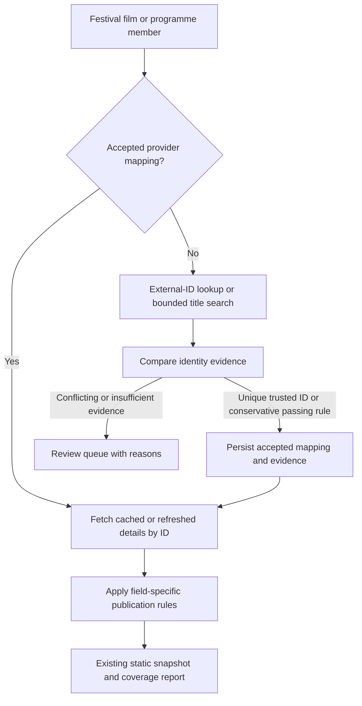

# Public movie identity matching patterns

Research checked November 5, 2026, for [issue #10](https://github.com/fruizrob/vivaelcine/issues/10). These projects demonstrate reusable patterns; none establishes that all festival-film identities can be resolved automatically.

The initial implementation now includes persistent accepted/rejected/review decisions, direct-ID refresh, sourced IMDb crosswalks, bounded search with year-free fallback, independent year proposals and retained metadata for suspended provider bindings. The three original cases have primary-source verified manual bindings. [Current workflow, coverage and review instructions](tmdb-pilot.md#persistent-identities-and-review). Director-alias resolution across films, probabilistic ranking and change-feed refresh below remain future options; the first patch preserves conservative acceptance.

## Jellyfin: provider IDs before title search

Jellyfin documents explicit TMDB and IMDb identifiers in media names to improve identification. It also reads local NFO metadata with precedence over remote metadata. These are precedents for a durable local identity decision rather than repeatedly guessing from a title. [Provider identifiers](https://jellyfin.org/docs/general/server/metadata/identifiers/), [NFO precedence](https://jellyfin.org/docs/general/server/metadata/nfo/).

In the inspected movie provider, `GetSearchResults()` first tries a supplied TMDB ID, then external IDs, then title/year search. `GetMetadata()` uses an existing TMDB ID or IMDb ID when present; otherwise it searches and selects a result. The resulting movie retains TMDB and IMDb provider IDs. [Pinned movie provider, lines 55–218](https://github.com/jellyfin/jellyfin/blob/0e6f035d76c0619b4d8b54eec0ca5906cfedaa26/MediaBrowser.Providers/Plugins/Tmdb/Movies/TmdbMovieProvider.cs#L55-L218).

Its `FindBestMatch()` compares normalized localized/original titles and gives a year bonus when the candidate is within one year. Exact titles score 8, whole-word prefixes 4, and compatible years 2. Ties preserve provider ordering. Crucially, the implementation starts with the first result and can return it even when every score is zero. This is useful ranking precedent, **not a safe acceptance rule to copy into this catalogue**. [Pinned scoring implementation, lines 178–254](https://github.com/jellyfin/jellyfin/blob/0e6f035d76c0619b4d8b54eec0ca5906cfedaa26/MediaBrowser.Providers/Plugins/Tmdb/TmdbUtils.cs#L178-L254).

The provider code also attempts TMDB external lookup with a TVDB identifier. That does not establish movie support: TMDB's official external-ID matrix supports TVDB IDs for television entities, not movies. Use an IMDb movie ID for this crosswalk unless the provider documents another supported movie identifier. [TMDB Find documentation](https://developer.themoviedb.org/reference/find-by-id).

## Radarr: persist the identity, refresh by ID

Radarr's movie metadata model stores `TmdbId` and `ImdbId`, alongside alternative titles and translations. [Pinned model](https://github.com/Radarr/Radarr/blob/479b6f2a17b5e5b0378659bc27401750f10829a7/src/NzbDrone.Core/Movies/MovieMetadata.cs#L24-L53).

Its mapping path prefers an existing TMDB ID, then IMDb ID, and only then title/year search. Search input accepts TMDB/IMDb URLs and `tmdb:`/`imdb:` forms. Some fallback mapping selects the first search result, so this is evidence for ID-first lookup, not guaranteed conservative entity resolution. [Pinned mapping and search implementation](https://github.com/Radarr/Radarr/blob/479b6f2a17b5e5b0378659bc27401750f10829a7/src/NzbDrone.Core/MetadataSource/SkyHook/SkyHookProxy.cs#L342-L521).

Refresh calls `GetMovieInfo(movie.TmdbId)`. It separately handles a deleted movie and an upstream replacement of a duplicate TMDB ID. This demonstrates that persisted identity needs explicit retirement/merge handling; a failed lookup need not trigger a new title-based reassignment. [Pinned refresh implementation, lines 69–104](https://github.com/Radarr/Radarr/blob/479b6f2a17b5e5b0378659bc27401750f10829a7/src/NzbDrone.Core/Movies/RefreshMovieService.cs#L69-L104).

## tinyMediaManager: configurable matching and field policies

The official movie settings document a score for every search result and a configurable automatic acceptance threshold. They also offer scraper fallback, region selection for release dates, and a mode that fills missing fields while preserving existing data. These establish separate decisions about finding an identity and choosing metadata values. [Movie settings](https://www.tinymediamanager.org/docs/movies/settings#automatic-scraper).

The Universal Scraper lets users choose a source for each metadata field. Provider selection can therefore differ by field after identification. [Official scraper documentation](https://www.tinymediamanager.org/docs/scrapers#universal-scraper).


## Official TMDB and TheTVDB documentation

Checked November 5, 2026. The app currently uses **TMDB (The Movie Database)**. **TheTVDB** is a different provider. Both document candidate discovery and identifier lookup; the acceptance/publication policy below is our design, not a provider guarantee.

| Need | Official capability | Implication for this project |
| --- | --- | --- |
| Resolve a known external ID | TMDB `GET /3/find/{external_id}?external_source=imdb_id` supports IMDb IDs for movies. The official matrix also supports movie Wikidata IDs, but **not TheTVDB movie IDs**. [Find by ID](https://developer.themoviedb.org/reference/find-by-id) | Prefer an independently sourced external ID to text search; validate media type and contradictory identity evidence. An IMDb ID copied from the same candidate is not independent confirmation. |
| Discover candidates | `GET /3/search/movie` searches original, translated and alternative titles; exposes `year`, `primary_release_year` and `page`. [Search movies](https://developer.themoviedb.org/reference/search-movie) | Use a year-filtered search as the first pass, then retry without the year when no candidate is accepted. Do not confuse search inclusion with a proven identity. |
| Retrieve a known movie | `GET /3/movie/{movie_id}`; `append_to_response` combines supported subordinate resources. [Movie details](https://developer.themoviedb.org/reference/movie-details), [append to response](https://developer.themoviedb.org/docs/append-to-response) | Once an identity is accepted, refresh by ID. The current importer already appends credits, release dates and alternative titles; those requests alone do not solve matching. |
| Compare names and titles | Movie alternative titles, credits and person details have separate endpoints. [Alternative titles](https://developer.themoviedb.org/reference/movie-alternative-titles), [credits](https://developer.themoviedb.org/reference/movie-credits), [person details](https://developer.themoviedb.org/reference/person-details) | Retain credited person IDs and verified aliases. Resolve a director once; spelling, script and name order then need not be re-decided for every film. Missing aliases remain unknown, not proof of a different person. |
| Model release events | `GET /3/movie/{id}/release_dates` distinguishes premiere, limited theatrical, theatrical, digital, physical and TV release types. [Release dates](https://developer.themoviedb.org/reference/movie-release-dates) | A main release date, film year and festival screening are different observations. Type 1 means premiere, not an independently established world premiere. |
| Refresh efficiently | Change lists identify changed movie/person/TV IDs; default window 24 hours, extendable to 14 days. [Tracking changes](https://developer.themoviedb.org/docs/tracking-content-changes) | Refresh accepted IDs on a modest schedule now. Change tracking is an option later; persist a watermark and recover gaps rather than assuming changes cover unlimited history. |

If **TheTVDB** was intended literally: its official [V4 API](https://thetvdb.github.io/v4-api/) and [OpenAPI source](https://github.com/thetvdb/v4-api/blob/main/docs/swagger.yml) document `/search` (including `type=movie`, aliases/translations, year and director), `/search/remoteid/{remoteId}` (e.g. IMDb/EIDR), and `/movies/{id}/extended`. Its own provider IDs can participate in our identity registry. Changing providers would still require identity reconciliation; no coverage improvement for this festival catalogue was measured. API access has negotiated-license and subscriber-supported models; consult the [official repository](https://github.com/thetvdb/v4-api) before integrating. Its documented `score` represents relative popularity, not a probability that two records describe the same film.

## Recommended pattern for issue #10

**Entity resolution, a persistent mapping between local and provider IDs, and field-level provenance.** Resolve which work a record describes separately from deciding which metadata to publish. This is our recommended design derived from the source patterns above; no claim of perfect automatic matching.



### 1. Persist the identity decision

Use a small local JSON registry initially. Each **Film** has an app-owned ID, aliases for the existing catalogue keys, accepted provider IDs and a decision record. Separately identified parts stay separate; a Programme never becomes a Film. Export metadata under the existing festival/film/component keys so public screening URLs and frontend contracts stay compatible.

The decision records `accepted`, `rejected` or `needs_review`, candidate/provider ID, method (`external_id`, `strict_rule_v1`, `manual`), evidence URLs or saved-response references, timestamp and rule version. Accepted/rejected decisions are durable; generated search results are not the source of truth. Enforce unique provider/ID ownership per canonical film; duplicate provider records require an explicit choice or a documented superseded mapping. Preserve legacy keys when sources rename titles. Store the source-identity fingerprint used for the decision; a source key being reused for a materially different work must enter review, even if the provider mapping was previously accepted.

On refresh, an accepted mapping bypasses textual rediscovery and retrieves that ID. Changed titles, years or runtimes produce metadata discrepancies; they do not silently erase an established identity. Deleted, merged or materially contradictory provider records enter review; retain the previous published snapshot while resolving the problem, and do not automatically switch to the next search hit.

### 2. Generate candidates broadly; accept conservatively

Order:

1. Reuse an accepted mapping.
2. Resolve an independently verified IMDb or other supported external ID; require a unique movie result and check work/part identity. Conflicting evidence enters review.
3. Search known original/festival titles and verified film aliases with a known year where available.
4. If no candidate is accepted, retry those searches **without a year constraint**, even if the first search returned unrelated candidates. An optional secondary route uses a verified director identity and their credits for generic titles.
5. Deduplicate candidate IDs before requesting details. Inspect the returned page rather than a silent five-result slice. Add bounded pagination only as needed; record the page/detail budget and `truncated` when reached. An exhausted search budget means unresolved, not absent from TMDB.

Use title, director identity, relevant release observations, runtime, countries/languages and part/version identity as evidence. Preserve existing negative cases. Name token similarity, transliteration and fuzzy title distance can rank review candidates; they cannot independently establish identity. Popularity is not identity evidence. Matching a known director's person ID is stronger than a name-string match, but does not distinguish all films or versions by that director.

For the first patch, retain conservative automatic acceptance for new candidates that pass the existing strict checks, and persist the method as `strict_rule_v1` rather than labelling it human-verified. Expanded searches and normalized aliases feed a review queue for conflicts. Do not invent a confidence percentage or a global ±1-year/runtime threshold to accept the remaining entries. A later score-based acceptance rule needs a labelled evaluation set, precision/recall measurement and a margin over the runner-up; a ranking score is not a probability.

### 3. Separate metadata publication from identity

| Field | Publication rule after identity acceptance |
| --- | --- |
| Poster | Valid artwork for that accepted work/part. A different distribution year or small runtime observation discrepancy does not independently suppress it. |
| Film year | Keep existing verified schedule year and its provenance. Fill a blank only from a verified film-year observation under the existing project policy. A TMDB main release year is a proposal, not an instruction to overwrite. |
| Release observation | Preserve date, country, release type, note and source. Keep regional, festival and reissue events distinct; do not collapse all of them into a single film year. |
| Festival appearance | Require a valid date and an unambiguous recognized festival identity. Keep unsupported/blank notes reviewable. Preserve curated festival/year precedence. |
| Premiere scope | World/international/national claims require appropriate explicit source evidence. Do not infer from type 1 or the earliest cached date. |
| Screening duration | Keep the official programme/screening runtime. Provider runtime remains a separate observation; no automatic timeline changes. |

Identity can be accepted while a field stays disputed or missing. Conversely, accepting a poster does not verify every festival note attached to that provider record. Track identity coverage, poster availability, classified history and sourced-year coverage separately.

### 4. Keep the implementation local

A proposed `scripts/film-identity.mjs` module owns resolution behind one small interface:

```js
resolveFilmIdentity(film, { decisions, request })
// -> { status, providerId, method, evidence, discrepancies, candidates }
```

Dependencies are passed in. The resolver returns decisions and evidence; the importer owns disk writes, review-report generation and atomic snapshot publication. One registry plus the existing response cache/report is enough initially. The current static site needs no new runtime service or matching dependency. If the proposed backend is later implemented, the same registry becomes Film, external-identity, identity-decision and source-observation records; do not build that backend merely to fix #10.

Fetch each provider movie/person once per run, cache successful responses and use bounded concurrency. Preserve offline replay. Honour HTTP 429 and retry transient failures with capped backoff; keep the previous published snapshot on failure. TMDB describes a changeable protective limit around 40 requests/second, not a throughput target or unlimited quota. [Rate-limit documentation](https://developer.themoviedb.org/docs/rate-limiting)

### 5. Verify the cases that matter

Use the public resolver interface for regression tests, including:

- Accepted ID survives localized-title, director display-name, year and runtime metadata changes; discrepancies remain visible.
- Silent Friend name order/year, Minotaur transliteration/title and The Fence title/year resolve only after their evidence is accepted. The current candidate IDs are not pre-approved by this proposal.
- Unrelated Animales and Réplica records remain rejected, including a similar runtime and exact title.
- Duplicate El Tigre del Este/Rumor candidates and distinct parts/versions require an explicit decision.
- Empty provider year/runtime remains missing evidence, not a fabricated zero or automatic different film.
- Reimport preserves accepted/rejected decisions; repeated screenings and cross-festival aliases share metadata without merging distinct parts.
- Posters/history can publish for an accepted identity while a year conflict stays unresolved; curated years and screening lengths survive refresh.
- Cache/network/404 failures do not erase published metadata or substitute another candidate; offline replay remains deterministic.

Deliver incrementally: persist current conservative matches with their actual method, verify the three original cases, review the broader 40-entry queue, then expand candidate retrieval and field enrichment. Track review decisions and false matches; the earlier 37-poster/57-history/8-year figures remain conditional inventories.
